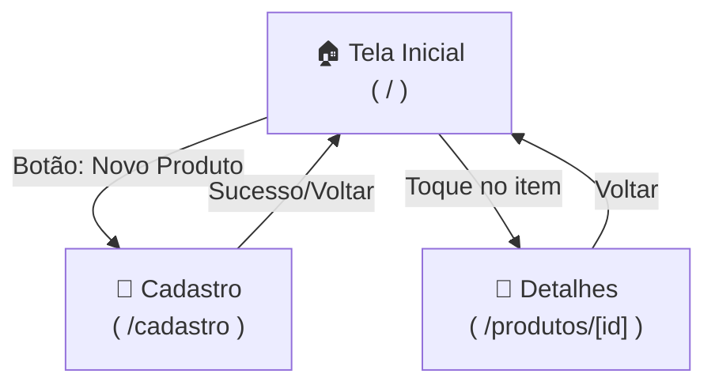

# Documentação de Telas e Navegação (UI/UX e Roteamento)

Este documento descreve as telas do aplicativo, os elementos visuais (componentes) que cada uma deve possuir para atender aos requisitos de interface (RT3), e o fluxo de navegação entre elas via Expo Router (RT1).

## 1. Mapa de Navegação (Stack)

A navegação será gerenciada exclusivamente por Stack (sem abas inferiores).

---

## 2. Estrutura Visual das Telas (Wireframe Lógico)

### 2.1. Tela Inicial (`app/index.tsx`)
**Objetivo:** Exibir as listas e servir de ponto central de navegação (Requisito RF3).

- **Cabeçalho/Ação Principal:**
  - Título da tela (ex: "Meus Produtos").
  - Botão de destaque: "Cadastrar Produto" (leva para `/cadastro`).
- **Seção 1: Produtos Ativos**
  - Título da Seção: **"Produtos ativos"**.
  - **Se houver itens:** Uma lista (Scroll) onde cada item mostra o `Nome` e o `Preço` (formatado como `R$ 12,50`). Ao tocar no item, navega para os detalhes.
  - **Se vazio:** Mensagem: *"Nenhum produto ativo no momento."*
- **Seção 2: Produtos Inativos**
  - Título da Seção: **"Produtos inativos"**.
  - **Se houver itens:** Idem à lista de ativos.
  - **Se vazio:** Mensagem: *"Nenhum produto inativo no momento."*

### 2.2. Tela de Cadastro (`app/cadastro.tsx`)
**Objetivo:** Receber dados validados do usuário para criar um produto (Requisito RF2).

- **Cabeçalho:** Título da tela (ex: "Novo Produto").
- **Formulário:**
  - **Input Nome:** Campo de texto simples. 
    - *Estado de erro:* Exibe texto em vermelho abaixo caso seja vazio após `.trim()`.
  - **Input Preço:** Campo numérico (ativar `keyboardType="numeric"` no React Native).
    - *Estado de erro:* Exibe texto em vermelho abaixo caso falhe na Regex de validação.
  - **Controle de Situação:** Um `Switch` ou Segmented Control para alternar entre "Ativo" e "Inativo" (Inicia como "Ativo").
  - **Ação Principal:** Botão **"Cadastrar Produto"**. (Fica bloqueado ou não avança enquanto os campos tiverem erro).

### 2.3. Tela de Detalhes (`app/produtos/[id].tsx`)
**Objetivo:** Mostrar os dados do produto selecionado e permitir a alteração rápida de seu status (Requisito RF4).

- **Cenário A: Produto Encontrado**
  - **Dados do Produto:**
    - Nome do produto (em destaque).
    - Preço formatado (R$).
    - Situação textual explícita: **"Ativo"** ou **"Inativo"**.
  - **Ação Dinâmica:**
    - Se o produto estiver Ativo: Exibe um botão **"Desativar produto"**.
    - Se o produto estiver Inativo: Exibe um botão **"Ativar produto"**.
  
- **Cenário B: Produto Não Encontrado (Id inexistente)**
  - Mensagem de destaque: **"Produto não encontrado"**.
  - Botão de fuga: **"Voltar para a tela inicial"**.

---

## 3. Padrões de Acessibilidade e Design (RT3)

- **Cores não são suficientes:** O status de "Ativo" ou "Inativo" não pode depender apenas de uma bolinha verde ou vermelha. O texto "Ativo" ou "Inativo" deve estar sempre explícito na tela de detalhes.
- **Rótulos Claros:** Todos os inputs no cadastro devem ter um label (rótulo visual, como "Preço do Produto").
- **Área útil (Safe Area):** As telas devem respeitar o notch/status bar do celular, usando componentes como `<SafeAreaView>` para o conteúdo não vazar da tela ou ser cortado pelo teclado.
